# Create a service in the UI

This tutorial walks through creating a mock service with the Mockey UI. It covers the same ground as
[Create a service from the command line](create-service-cli.md), but every step happens in the browser.

The tutorial mocks a live API from the U.S. National Highway Traffic Safety Administration (NHTSA). The vPIC
API lists the vehicle models for a make, and make 440 is Aston Martin:

```text
https://vpic.nhtsa.dot.gov/api/vehicles/GetModelsForMakeId/440?format=json
```

By the end, you'll have a service that forwards requests to the real API, a scenario saved from a real
response, a scenario written by hand, and a mock that serves either scenario without calling NHTSA at all.

## What you need

- JDK 21 or later.
- The Mockey server and UI jars. Build them from the root of the repository:

  ```shell
  ./gradlew :mockey-server:assemble :mockey-ui:assemble
  ```

- A browser.
- `curl`, to call the mock the way a client would.
- Network access to `vpic.nhtsa.dot.gov`.

## Step 1: Start the server

Start the server in its own terminal:

```shell
java -jar mockey-server/build/libs/mockey-server-3.0.0-rc.2-runnable.jar
```

The server keeps everything in memory, so the services you create disappear when it stops. Add `--writable`
to save them to the `mockey-definitions` directory instead.

If your network inspects HTTPS traffic with a company certificate, Java won't trust the vPIC certificate, and
the mock answers with a `502` that mentions PKIX. On macOS, tell Java to use the keychain:

```shell
java -Djavax.net.ssl.trustStoreType=KeychainStore -Djavax.net.ssl.trustStore=NONE \
  -jar mockey-server/build/libs/mockey-server-3.0.0-rc.2-runnable.jar
```

For other platforms and other options, see
[The certificate of a real service](../server.md#the-certificate-of-a-real-service).

## Step 2: Start the UI

The UI is a separate program that talks to the server's admin API. Start it in a second terminal:

```shell
java -jar mockey-ui/build/libs/mockey-ui-3.0.0-rc.2-runnable.jar
```

It connects to the admin API at `http://127.0.0.1:8081` by default. Open <http://localhost:8082/> in the
browser. The Services page is empty for now:

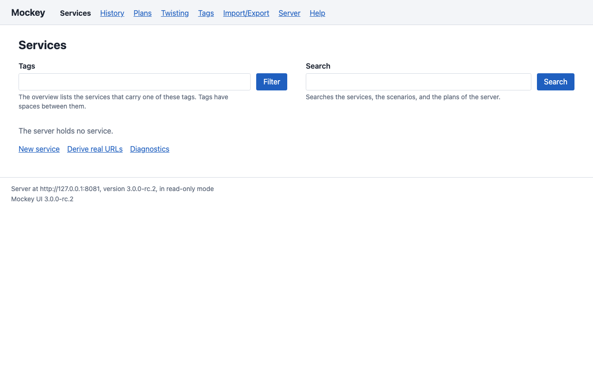

The navigation bar at the top leads to every part of the UI. The footer shows which server the UI is talking
to and its version.

## Step 3: Create the service

A service ties a mock URL pattern to one or more real URLs. Click **New service** to open the form:

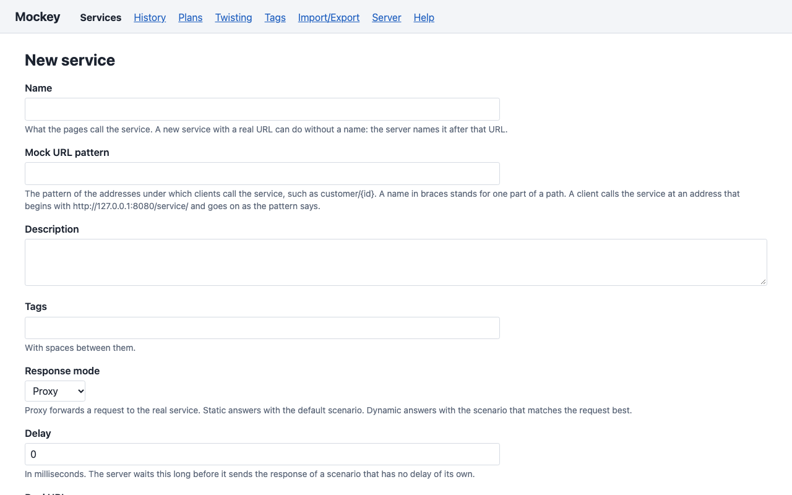

Fill in these fields and leave the rest as they are:

| Field            | Value                                                                        |
|------------------|------------------------------------------------------------------------------|
| Name             | `NHTSA vPIC models`                                                          |
| Mock URL pattern | `vpic/models`                                                                |
| Description      | `Models for make 440 (Aston Martin) from the NHTSA vPIC API`                 |
| Response mode    | Proxy                                                                        |
| Real URLs        | `https://vpic.nhtsa.dot.gov/api/vehicles/GetModelsForMakeId/440?format=json` |

Here's what each field does:

- **Name** is the label shown on the pages and in the history.
- **Mock URL pattern** is the address that clients call, relative to `http://localhost:8080/service/`.
- **Response mode** decides where the answer comes from. Proxy forwards each request to a real URL, Static
  serves the default scenario, and Dynamic picks the scenario that matches the request best.
- **Real URLs** lists the real service URLs. The **Default** radio button marks the one that Proxy mode uses.

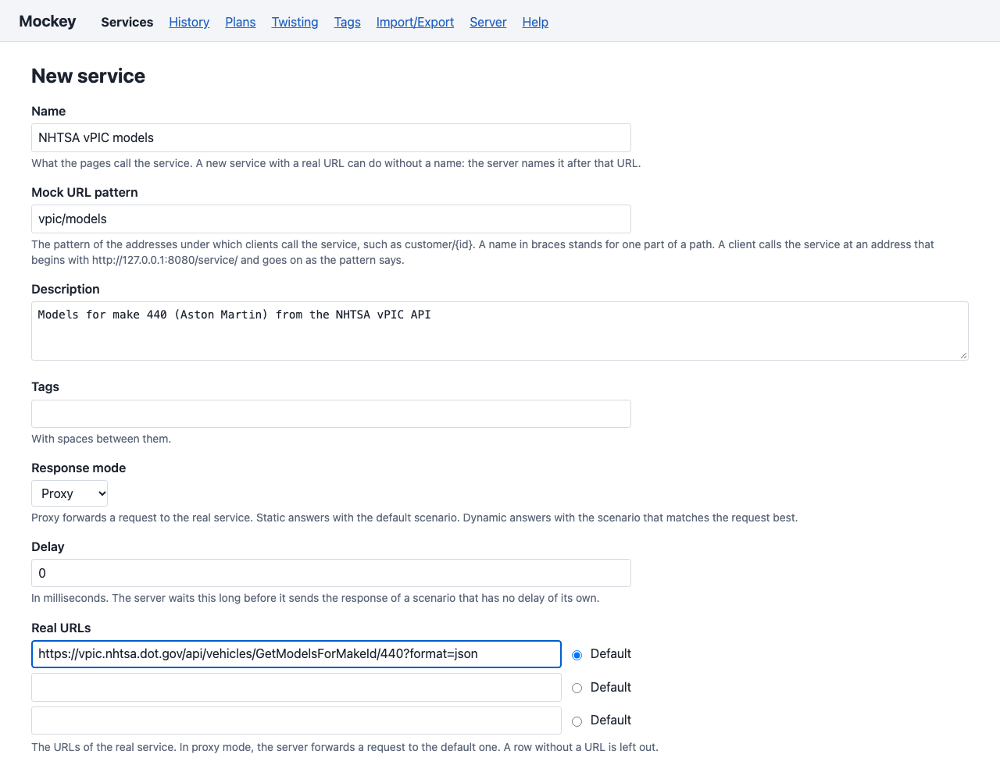

Click **Create the service**. The UI shows the new service with a notice that it was created:

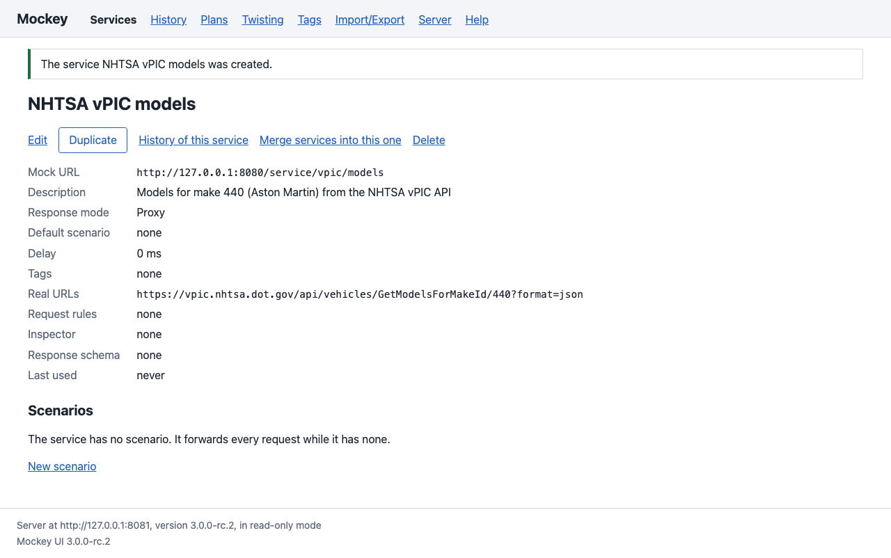

The mock URL has to be unique. If another service already uses `vpic/models`, the form shows an error instead.

## Step 4: Call the mock

Call the mock URL from a terminal, the same way a client would:

```shell
curl -i http://localhost:8080/service/vpic/models
```

Because the service is in proxy mode, Mockey forwards the request to the real URL and passes the answer back:

```text
HTTP/1.1 200 OK
Content-Type: application/json
Access-Control-Allow-Origin: *
Content-Length: 1571

{"Count":18,"Message":"Response returned successfully","SearchCriteria":"MakeId:440","Results":[...]}
```

## Step 5: Look at the history

Every call to a mock is recorded in the history. Click **History** in the navigation bar:

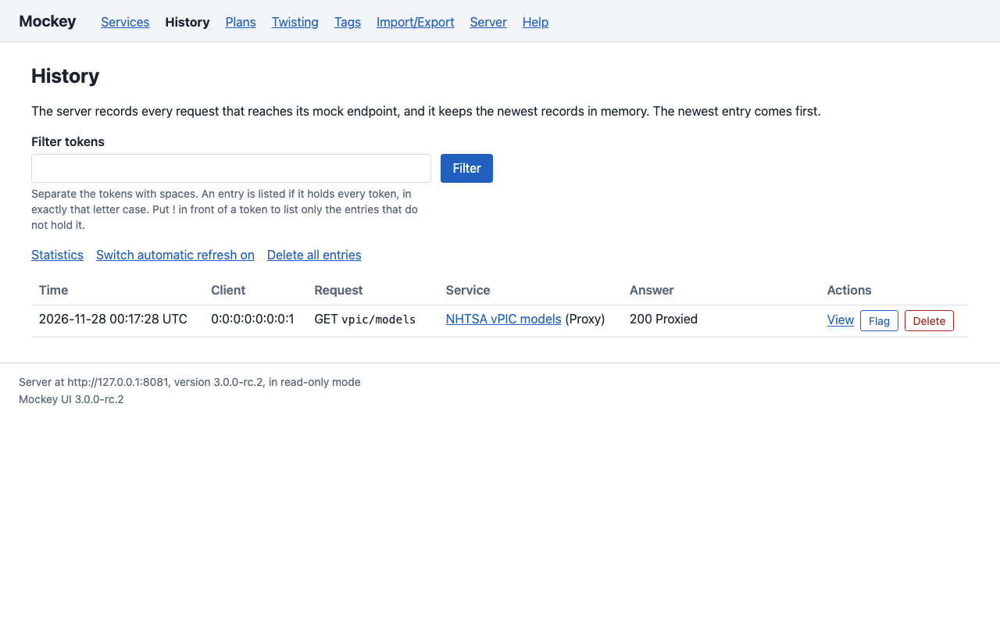

The answer `200 Proxied` means the response came from the real service. Click **View** to open the entry:

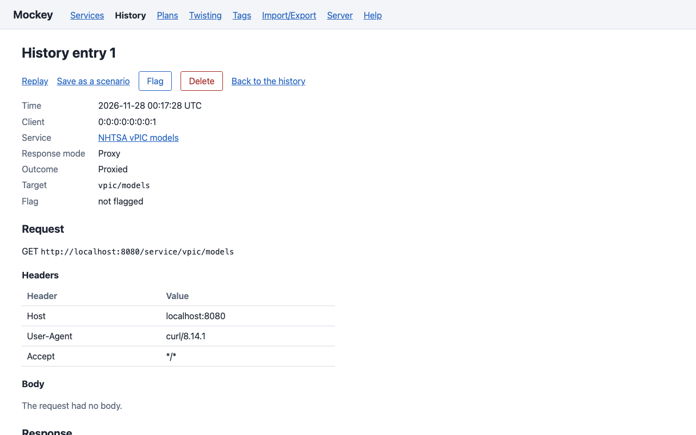

The entry shows the full request and the full response, including the headers and the body. From here, you
can replay the request, flag the entry so it's easy to find later, or delete it.

## Step 6: Save the response as a scenario

A scenario is a saved response that the mock can serve without calling the real service. The easiest way to
get a realistic one is to save it from a history entry. On the history entry, click **Save as a scenario**,
and enter `Aston Martin models` as the name:

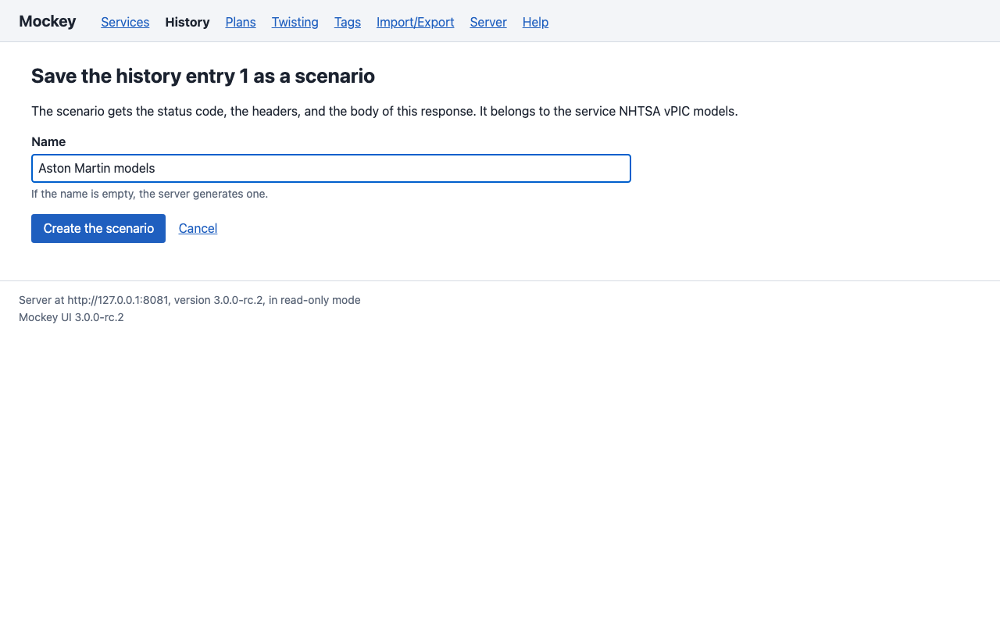

Click **Create the scenario**. The UI opens the new scenario, which copies the status code, the headers, and
the body of the recorded response:

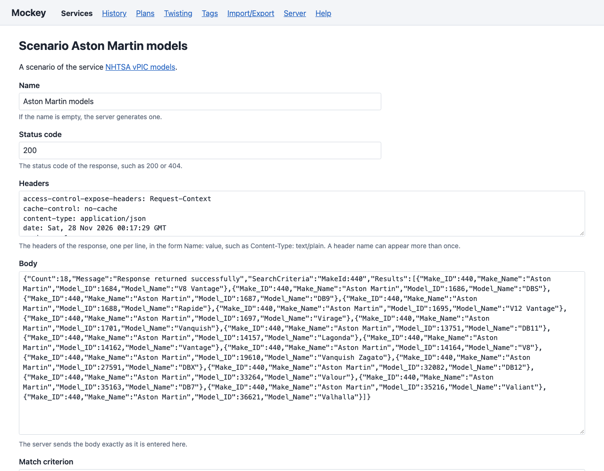

The header names are in lowercase, the way the real service sent them. Every field is editable, so you can
trim the body or change a header and click **Save the scenario**.

The first scenario of a service becomes its default scenario automatically.

## Step 7: Write a scenario by hand

Scenarios don't have to come from the history. This one describes an edge case that's hard to get from the
real service: a make with no models.

Click the **NHTSA vPIC models** link at the top of the scenario page to go back to the service, and then
click **New scenario**. Fill in the form:

- **Name**: `No models`
- **Status code**: `200`
- **Headers**: `Content-Type: application/json`
- **Body**: `{"Count":0,"Message":"Response returned successfully","SearchCriteria":"MakeId:440","Results":[]}`

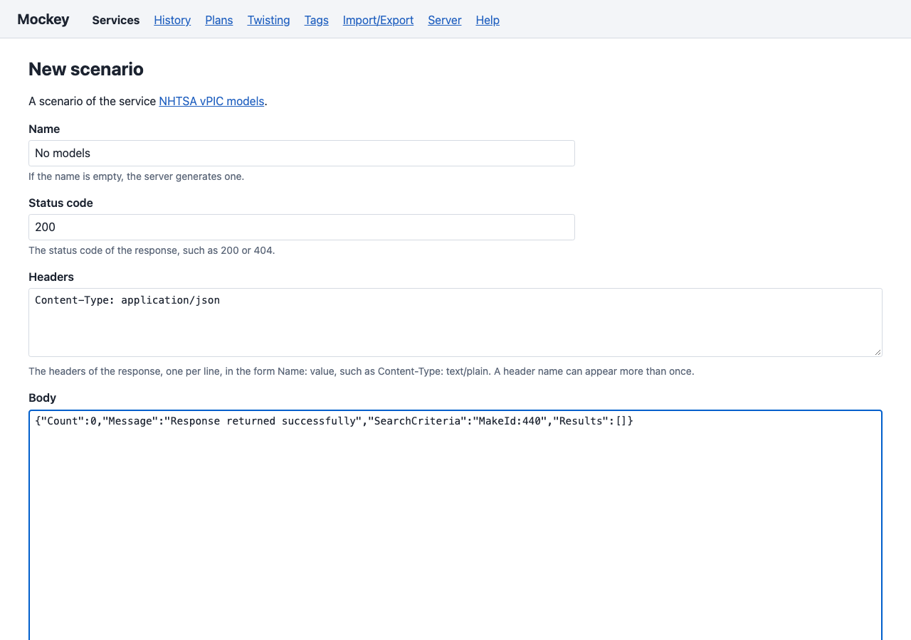

Include the `Content-Type` header. A scenario without one sends its body with no content type at all.

Click **Create the scenario**.

## Step 8: Serve the scenario instead of the real service

Go back to the service and click **Edit**. Change **Response mode** to Static. The **Default scenario**
field already shows Aston Martin models, the scenario that answers in static mode:

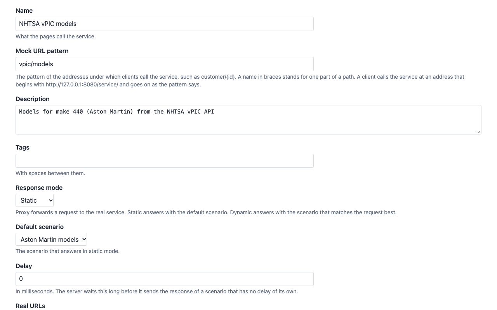

Click **Save the service**. The service page now shows Static as the response mode and lists both scenarios,
with a `default` badge next to Aston Martin models:

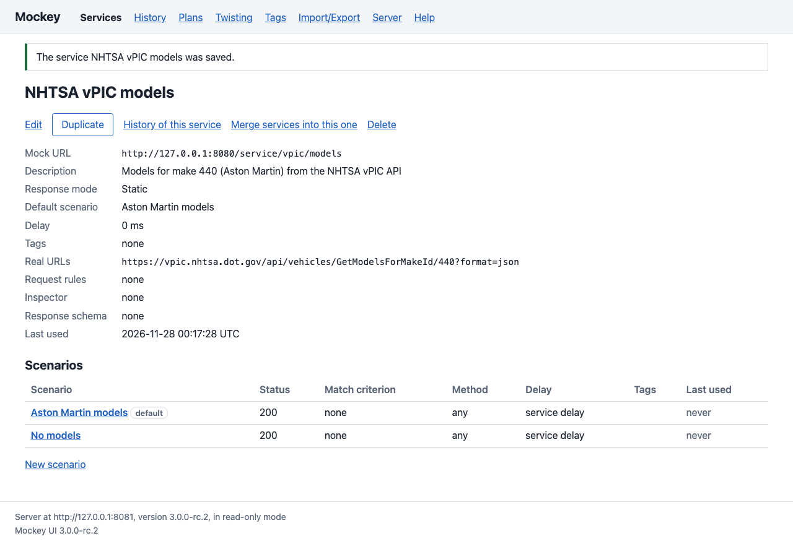

Call the mock again:

```shell
curl -s http://localhost:8080/service/vpic/models | jq '.Count'
```

```text
18
```

The answer is the same list of 18 models, but now it comes from the scenario. The History page records the
call with a different answer, because the real service was never called.

A static service with no scenarios at all falls back to proxy mode, so it's safe to switch modes before any
scenario exists.

## Step 9: Change the default scenario

Click **Edit** once more, choose No models in the **Default scenario** field, and click **Save the
service**. The `default` badge moves to No models:

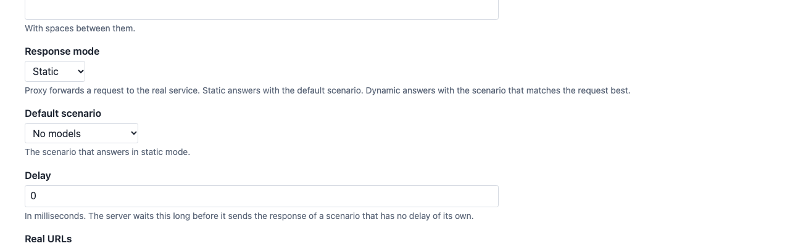

Call the mock one last time:

```shell
curl -i http://localhost:8080/service/vpic/models
```

```text
HTTP/1.1 200 OK
Content-Type: application/json
Access-Control-Allow-Origin: *
Cache-Control: no-store, no-cache, must-revalidate, max-age=0, post-check=0, pre-check=0
Pragma: no-cache
Expires: Tue, 03 Jul 2001 06:00:00 GMT
Last-Modified: Sat, 28 Nov 2026 00:24:53 GMT
Content-Length: 97

{"Count":0,"Message":"Response returned successfully","SearchCriteria":"MakeId:440","Results":[]}
```

The scenario didn't set any caching headers, so Mockey added its own to keep clients from caching the mock.

To go back to the real service, edit the service and set **Response mode** to Proxy. The scenarios stay where
they are, ready for the next time.

## Next steps

- [Create a service from the command line](create-service-cli.md) does the same steps with `curl` and the
  admin API, which is handy for scripts and test setup.
- [The UI](../ui.md) documents every page and option, including how to point the UI at another server.
- [The server](../server.md) covers the ports, the mock endpoint, saving definitions, and certificates.
